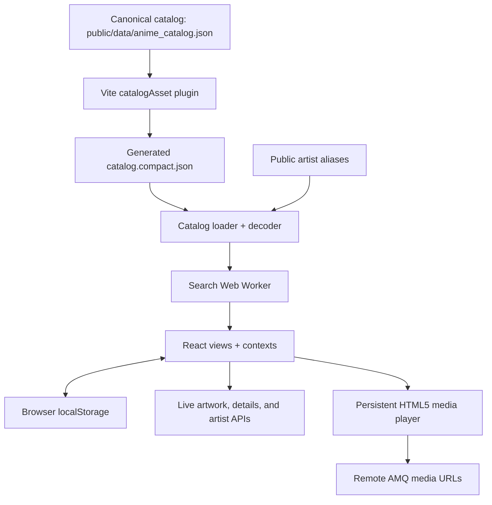

# Anime Song Database

A browser-based anime music catalog for finding opening, ending, and insert songs, building personal playlists, and listening through a persistent audio/video player. The bundled catalog contains **38,821 tracks from 1924–2026**, with English and Japanese-display titles.

**[Open the app](https://ltrieu22.github.io/anime-music-library/)**

## Features

- **Catalog search:** search anime titles, alternate names, artists, and song names. Matching ignores case and Latin accents, supports partial words, and expands known artist/group aliases while preserving Japanese voicing distinctions.
- **Filters and sorting:** opening/ending/insert filters, anime season, a year-range slider, decade presets, sortable columns, and 100-song result pages. Filtering and sorting apply to all matches before pagination.
- **English / Japanese title display:** switch between English and the provider's Japanese-display name, usually romaji. Searches always include every available title variant, regardless of the selected display language.
- **Artist discovery:** click an artist to search AniSongDB by canonical numeric artist IDs, including its structured group and collaboration credits.
- **My Collection:** save catalog songs, add or edit manual entries, create and rename playlists, toggle membership across multiple playlists, reorder songs, and delete playlists individually or in bulk. Saved Songs and playlists have Play and Shuffle controls.
- **Private notes:** attach searchable notes to songs, view them in a separate Notes tab, and keep them even after removing a saved song. Note text stays in the browser.
- **Persistent playback:** play audio or video, seek, adjust remembered volume, show a draggable/resizable floating video window, or enter fullscreen. Browsing and queue edits preserve current playback.
- **Editable queue:** Add to queue, Play next, duplicate song occurrences, drag or keyboard reordering, removal, Clear upcoming, and explicit Off / Repeat one / Repeat all modes.
- **History and restoration:** replay the latest 100 distinct listened songs. Reloading restores the queue, position, and repeat mode paused; closing the player clears its saved session.
- **Sharing and recovery:** copy public song links, explicitly share catalog searches, import/export JSON backups, retry catalog-loading failures, and undo song, playlist, membership, or queue removals for five seconds.
- **Responsive controls:** desktop tables, mobile cards, keyboard-accessible menus and reorder controls, and device media controls through the browser's Media Session API where supported.

## Run locally

Use **Node.js 24.22.1 or a newer 24.x release** and npm. The tested version is pinned in [.nvmrc](.nvmrc) and [package.json](package.json).

```sh
npm ci
npm run dev
```

Open [localhost:3000](http://localhost:3000). The development command starts Express with Vite middleware and hot reload. No API keys, account, database installation, or title-enrichment run is required.

To build and preview the static app:

```sh
npm run build
npm run preview
```

The build creates the Vite frontend and `dist/server.cjs`. To serve the built app with the optional Express API, set `NODE_ENV=production` before starting it:

```powershell
# PowerShell
$env:NODE_ENV = 'production'
npm start
```

On a POSIX shell, use `NODE_ENV=production npm start`. The Express port is currently fixed at **3000**; `npm run preview` prints its own URL.

Optional environment variables:

| Variable | Purpose |
| --- | --- |
| `NODE_ENV=production` | Serve the built frontend from Express instead of starting Vite middleware. |
| `VITE_BASE_PATH` | Override the frontend asset base at build/dev startup; the default is `./`, supporting repository subpaths such as `/anime_db/`. |
| `DISABLE_HMR=true` | Disable Vite hot reload and file watching. |

## Project directory

```text
anime_db/
├── public/
│   ├── data/
│   │   ├── anime_catalog.json          # Canonical, enriched song catalog
│   │   └── artist_aliases.json         # Alias map used by the browser
│   └── marcille.png                   # App logo and favicon
├── data/
│   ├── artist_aliases.json            # Alias map used by Express
│   ├── catalog-title-enrichment-report.json
│   └── entries.json                   # Separate file-backed Express entries
├── src/
│   ├── main.tsx                       # React entry point
│   ├── App.tsx                        # Views, filters, collection, and dialogs
│   ├── index.css                      # Tailwind and shared styles
│   ├── components/
│   │   ├── collection/                # Library, playlists, picker, and history
│   │   ├── player/                    # Player bar, floating video, and queue
│   │   └── ...                        # Song table, filters, hover cards, dialogs
│   ├── context/                       # Titles, playback, playlists, sharing, Undo
│   ├── services/                      # Search, APIs, caching, storage, and backups
│   │   ├── fixtures/                  # Recorded title-enrichment test responses
│   │   └── *.test.ts                  # Service unit tests
│   ├── types.ts                       # Catalog, collection, and note models
│   ├── types/player.ts                # Tracks and queue occurrences
│   └── utils/                         # Player conversion and AniList links
├── scripts/
│   ├── catalogAsset.ts                # Vite plugin generating compact catalog data
│   ├── enrich-titles.ts               # Resumable AniSongDB title enrichment
│   ├── validate-title-enrichment.ts   # Validate and explicitly promote enrichment
│   ├── browser-harness.mjs            # Isolated production-browser test server
│   └── profile-*                      # Catalog size, startup, and search profiling
├── tests/                             # Browser fixtures, runners, and backup samples
├── docs/                              # Implementation notes and performance reports
├── .github/workflows/deploy.yml        # GitHub Pages build and deployment
├── server.ts                          # Optional Express server and API proxies
├── index.html                         # Frontend HTML shell and page metadata
├── vite.config.ts                     # React, Tailwind, catalog plugin, asset base
├── tsconfig.json
├── .nvmrc                             # Tested Node.js version
├── package.json
├── package-lock.json
└── README.md
```

`dist/` is generated build output. Title-enrichment responses and intermediate files live in the ignored `.cache/title-enrichment/` directory. The two artist-alias files serve different runtimes; keep their contents aligned when updating aliases.

## Architecture

The frontend uses **React 19, TypeScript, Vite 6, and Tailwind CSS 4**, with Motion for animations/reordering and Lucide for icons. Express 4 supplies the optional server; esbuild bundles its entry point. The deployed GitHub Pages app runs as a static frontend.



- **Catalog loading:** [catalogAsset.ts](scripts/catalogAsset.ts) derives a lossless dictionary-encoded payload from the canonical JSON during builds and serves it on demand in development. It reduces the current raw payload from about **17.40 MB to 8.25 MB** while retaining titles, IDs, seasons, and media URLs. [catalogLoader.ts](src/services/catalogLoader.ts) loads the catalog and aliases together, shares concurrent attempts, caches successes, and leaves failures retryable.
- **Search:** [catalogEngine.ts](src/services/catalogEngine.ts) sends the loaded catalog to one module Web Worker. Shared search services normalize text, expand aliases, merge locally matched note snapshots, deduplicate, filter, sort, and paginate. An eight-query cache reuses ordered results across pages. Request IDs and abort handling prevent stale replies from replacing newer searches. Browsers without Worker support use the synchronous implementation.
- **Application state:** React contexts manage title language, playback, playlists, sharing, and Undo. `App.tsx` coordinates the Catalog, My Collection, and Notes views. Add, Edit, Notes, Data, and playlist-picker dialogs load on first use.
- **Playback:** [playerQueue.ts](src/services/playerQueue.ts) is a pure queue reducer. Each playback occurrence has its own ID, so duplicate songs remain independently editable. [PlayerContext.tsx](src/context/PlayerContext.tsx) owns queue transitions, storage, and media events; [MusicPlayer.tsx](src/components/player/MusicPlayer.tsx) keeps one playback `<video>` element mounted for both audio listening and visible video.
- **Hosting:** the main Catalog view searches in the browser in both deployment modes. Express additionally exposes catalog routes and anime-search/artwork proxies. When those proxies are absent on static hosting, supported lookups fall back to direct browser requests.

The [GitHub Actions workflow](.github/workflows/deploy.yml) runs TypeScript checks, offline unit tests, a production build, and the full browser suite on pull requests targeting `main` or `master`, pushes to those branches, and manual dispatch. Playwright is pinned in the lockfile and CI installs its matching Chromium browser. Successful pushes/manual runs publish `dist/` to GitHub Pages; pull requests only run checks. Deployment depends on every check passing. Pages serves static files and does not execute the Express server.

## Data sources and APIs

### Bundled catalog

[public/data/anime_catalog.json](public/data/anime_catalog.json) is the source of truth for the shipped catalog. It contains AniSongDB-derived song records identified as `song-<annSongId>`; the numeric portion is the ANN song ID exposed by AniSongDB. The repository ships this snapshot and its title-enrichment tooling, but does not include a general full-catalog download/update command. Normal builds do not refresh it from an API.

See the [dataset maintenance notes](docs/dataset-updates.md) for freshness checks and the proposed update process.

| Current snapshot | Count |
| --- | ---: |
| Tracks / unique catalog IDs | 38,821 |
| Openings | 8,873 |
| Endings | 15,317 |
| Insert songs | 14,631 |
| Rows with English and Japanese-display titles | 38,821 |
| Rows with nonempty alternate-name lists | 2,493 |

Each record stores:

- `id`, `anime_name`, `anime_year`, and `anime_vintage` for identity and anime airing period.
- `artist`, `song_name`, and `theme_type` for song credits and theme classification.
- `video_url`, `audio_url`, and `anilist_id` for playback and anime artwork/detail lookup.
- `anime_name_english`, `anime_name_romaji`, and `anime_alt_names` for bilingual display and search.

The year and season describe the **anime's catalog airing period**, not the song's release date. Missing seasons remain Unknown. Artist alias expansion comes from the repository's `artist_aliases.json` files.

### Live services

| Service | Endpoint used | Role |
| --- | --- | --- |
| [AniSongDB](https://anisongdb.com/) | `POST https://anisongdb.com/api/ann_song_ids_request` | Resolve artist credits for displayed song IDs; also supplies title metadata to the maintenance script. Runtime hydration batches up to 500 IDs; title enrichment batches 100. |
| AniSongDB | `POST https://anisongdb.com/api/artist_ids_request` | Fetch songs by canonical artist IDs, then filter/sort/page the response locally. |
| [AniList](https://anilist.co/) | `POST https://graphql.anilist.co` | Anime-title suggestions, cover/banner images, and details such as year, format, genres, score, episodes, and studio. Linked AniList IDs are preferred over title lookup when available. |
| [AnimeThemes](https://animethemes.moe/) | `GET https://api.animethemes.moe/anime` | The Express Add Song lookup requests anime themes, song artists, and images. The main Catalog view uses the bundled catalog. |
| [Kitsu](https://kitsu.io/) | `GET https://kitsu.io/api/edge/anime` | Title-based fallback for artwork and basic anime details when AniList cannot provide them. |
| Anime Music Quiz media host | `https://naedist.animemusicquiz.com/…` | Streams the media files referenced by catalog records. This is media hosting, rather than a metadata API. |

On static hosting, Add Song's API lookup falls back to AniList suggestions, which contain no theme-track list. Saving songs from the bundled Catalog and entering songs manually remain available. Media and uncached external lookups require network access; the app does not download tracks or provide a service-worker offline mode.

Ordinary catalog query text and note text are processed locally. Displayed catalog pages can still trigger AniSongDB artist-credit requests using song IDs. Add Song's separate anime lookup and title-based artwork fallbacks send the relevant anime query/title to their providers.

### Request caching and pacing

AniList calls share a serialized client with at least **2.5 seconds between request starts**, shared identical in-flight requests, a 20-request pending limit, and ten-second request timeouts. Rate-limit and outage responses trigger a cooldown of at least 60 seconds, respecting longer provider delays. Browser pacing persists across reloads and coordinates tabs with Web Locks where supported.

Successful anime details are cached for **seven days** and cover URLs for **30 days**, each bounded to 500 entries. Hover lookups wait 400 ms; playback warms current/next artwork and queue rows load artwork near the viewport. Express also caches anime searches for one hour and cover/details results for 24 hours. See [AniList request behavior](docs/anilist-api-usage.md).

### Optional local API

These routes exist when running `server.ts` or the built server:

| Routes | Purpose |
| --- | --- |
| `GET /api/health` | Server health and timestamp. |
| `GET /api/catalog/songs` | Search the bundled catalog with `q`, `yearMin`, `yearMax`, `season`, `themeType`, `sortKey`, `sortOrder`, `limit`, and `offset`. |
| `GET /api/anisongdb/songs`, `GET /api/animethemes/songs` | Compatibility aliases for the same local catalog handler. |
| `GET /api/anime/search?q=…` | AnimeThemes/AniList lookup used by Add Song. |
| `GET /api/anime/cover?title=…&id=…` | Anime details/artwork lookup, with AniList ID or title and Kitsu fallback. |
| `GET/POST /api/entries`, `PUT/DELETE /api/entries/:id` | Separate file-backed entry CRUD in `data/entries.json`. |
| `POST /api/entries/import`, `POST /api/entries/reset` | Import/reset those file-backed entries. |

The current UI stores Saved Songs in browser `localStorage`, including when Express is running. Its collection operations do not use the file-backed `/api/entries` routes. There is no account system or cross-device synchronization.

## How title enrichment works

Title enrichment is a **data-maintenance workflow**, separate from runtime AniList artwork lookup. The shipped catalog is already enriched.

1. [enrich-titles.ts](scripts/enrich-titles.ts) reads the canonical catalog and selects explicit `--ids` or `--full`. Eligible IDs must have the exact `song-<positive integer>` form.
2. It requests AniSongDB records by ANN song ID in sequential batches of 100, pausing between batches. Complete responses are saved in `.cache/title-enrichment/responses/`, allowing interrupted or bounded runs to resume. Requests have bounded retries/timeouts and respect rate-limit delays.
3. [titleEnrichment.ts](src/services/titleEnrichment.ts) requires exactly one candidate with the same `annSongId`. It checks song name, artist, theme type, vintage, year, linked AniList ID when both are present, and existing title metadata. AniList IDs are consistency checks; they do not choose a match. Missing, duplicate, or conflicting records are reported as `unmatched`, `ambiguous`, or `mismatched`.
4. Matched upstream fields are copied without translation or generated romanization:

   | AniSongDB field | Catalog field |
   | --- | --- |
   | `animeENName` | `anime_name_english` |
   | `animeJPName` | `anime_name_romaji` |
   | `animeAltName` | `anime_alt_names` |

5. The script writes progress and preview reports, including a SHA-256 of its source. Preview runs leave the canonical catalog unchanged. `--stage` requires a full run with no pending IDs and writes `.cache/title-enrichment/anime_catalog.enriched.json`; unresolved rows retain their original data.
6. [validate-title-enrichment.ts](scripts/validate-title-enrichment.ts) checks row count/order, unique IDs, all existing fields, expected catalog coverage, sample mappings, note keys, and metadata fingerprints. Only the three title metadata fields may be added.
7. Explicit `--promote` preserves the original source, atomically replaces the canonical catalog with validated output, and writes [catalog-title-enrichment-report.json](data/catalog-title-enrichment-report.json). The next build regenerates the compact payload.

For example, `song-34830` retains the original `anime_name: "The Heike Story"` and gains the Japanese-display title `"Heike Monogatari"`. Song IDs, saved-copy identities, note keys, and media URLs stay intact. Older saved copies can resolve missing title metadata by exact `source_song_id` without rewriting their stored identity.

Maintenance commands below make real **AniSongDB** requests when the requested responses are not already cached. `--preview` is a preview of catalog changes, not a network-free dry run.

```sh
# Small sample; cache responses and inspect the preview.
npm run enrich:titles -- --ids "song-34830,song-34831" --preview

# Process at most 1,000 uncached IDs per invocation; repeat to resume.
npm run enrich:titles -- --full --limit 1000 --preview

# After completing the preview, stage the full result and validate it.
npm run enrich:titles -- --full --stage
npm run validate:titles
```

Review `.cache/title-enrichment/preview.json` and `validation.json` before explicitly promoting:

```sh
npm run validate:titles -- --promote
```

Cached unresolved results are reused unless `--retry-unresolved` is supplied. The validator is deliberately tied to the current **38,821-row snapshot**, its source hash, category counts, and sample records; changing the catalog baseline requires updating those checks and keeping the original/preview/staged files consistent.

The checked-in report records **38,821 matched rows, zero unresolved mappings**, full English/Japanese-display coverage, and preservation of all existing fields and persistent identities.

## Local storage and backups

Personal data belongs to the browser profile and site origin. A fresh browser starts with an empty collection; localhost and GitHub Pages have separate storage.

Saved Songs additions and edits report storage failures without changing the displayed library; forms retain their drafts for retry. Reset writes Saved Songs and notes together, attempts rollback if either write fails, and closes playback only after success. Missing media on a saved catalog copy is recovered by exact `source_song_id`. Songs without their own media or an exact playable catalog match show **Media unavailable** instead of borrowing another theme from the same anime.

| Storage key | Contents |
| --- | --- |
| `anime_songs_db_v1` | Saved Songs and manual entries. Catalog copies retain `source_song_id`; manual playlist references use a separate `local_song_id`. |
| `anime-db:playlists` | Named playlists, stable IDs, song references/snapshots, and order. |
| `anime_song_notes_v1` | Private note text and song snapshots, up to 5,000 characters per note. |
| `anime-db:player-session-v1` | Queue occurrence IDs, current index, position, and repeat mode; playback resumes only after Play. |
| `anime-db:recent-songs-v1` | The latest 100 distinct songs that actually played. |
| `anime-db:title-language` | EN/JP display preference, defaulting to English. |
| `anime-db:player-volume-v1`, `anime-db:pip-layout-v1` | Remembered gain (40% initially) and floating-video layout. Mute is transient. |
| `anime_details_v1`, `anime_cover_urls_v1`, `anilist_request_pacing_v1` | Provider caches and request pacing/cooldowns. |

**Manage Data → Export** produces a version 2 JSON backup containing Saved Songs, notes, and custom playlists with their identities, snapshots, and song order. Imports validate and preview changes before replacing the included sections, with rollback attempted if a storage write fails.

| Import format | Replaces | Preserves |
| --- | --- | --- |
| Version 2 backup | Saved Songs, notes, playlists | History and preferences |
| Version 1 backup | Saved Songs and notes | Existing playlists, history, preferences |
| Legacy song array | Saved Songs | Existing notes, playlists, history, preferences |

Importing closes playback and clears its saved queue. Backups exclude the catalog, player session, listening history, preferences, caches, and temporary Undo offers. **Restore Default Database** empties Saved Songs and notes and closes playback; custom playlists are kept. Clearing site data removes the browser's personal data, so export a backup when moving to another browser or device.

## Development and verification

```sh
npm run lint   # TypeScript checking (tsc --noEmit)
npm test       # Service tests through tsx and node:test
npm run build  # Production frontend and Express bundle
git diff --check
```

Unit tests cover catalog fidelity/loading, bilingual search, artist matching, pagination, worker failures, API pacing, storage, backups, queues, history, volume, sharing, and Undo. The unit-test setup blocks unmocked fetches; enrichment tests inject recorded/fake responses rather than calling live providers.

Browser tests use the pinned **Playwright** development dependency and its matching Chromium browser. Install the browser once after `npm ci` (use `npx playwright install --with-deps chromium` on Linux if system dependencies are needed). Runners use isolated browser storage and mock or block external provider requests. They default to Playwright's Chromium; `BROWSER_CHANNEL=msedge` can select an installed Edge, and `PLAYWRIGHT_MODULE` can optionally point to another installation's absolute `index.mjs` path.

```sh
npx playwright install chromium
npm run build
npm run test:browser                 # All fixtures and production UI checks

# Individual runners are also available:
node tests/browser-fixtures.mjs       # Five fixtures; starts its own Vite server

# Production UI checks; run npm run build first.
node tests/catalog-loading.mjs
node tests/collection-reliability.mjs
node tests/anilist-usage.mjs
node tests/playlist-picker.mjs
node tests/playlist-management.mjs
node tests/play-next-repeat.mjs
node tests/playback-restoration.mjs
node tests/media-session.mjs
node tests/removal-undo.mjs
node tests/mobile-layout.mjs
```

Profiling tools measure the existing catalog and local production build:

```sh
node --import tsx scripts/profile-catalog.ts
node scripts/profile-initial-load.mjs
node scripts/profile-search.mjs
```

Browser/OS support determines actual fullscreen, clipboard, and device media-control behavior. See the focused documentation for implementation details, measured performance, and verification scope:

- [Test setup and browser runners](tests/README.md)
- [Catalog loading and initial-load performance](docs/initial-load-performance.md)
- [Worker search responsiveness](docs/search-responsiveness.md)
- [AniList caching and request pacing](docs/anilist-api-usage.md)
- [Play next and repeat behavior](docs/player-queue.md)
- [Listening history and paused restoration](docs/playback-restoration.md)
- [Device media controls](docs/device-media-controls.md)
- [Undo removals](docs/removal-undo.md)
